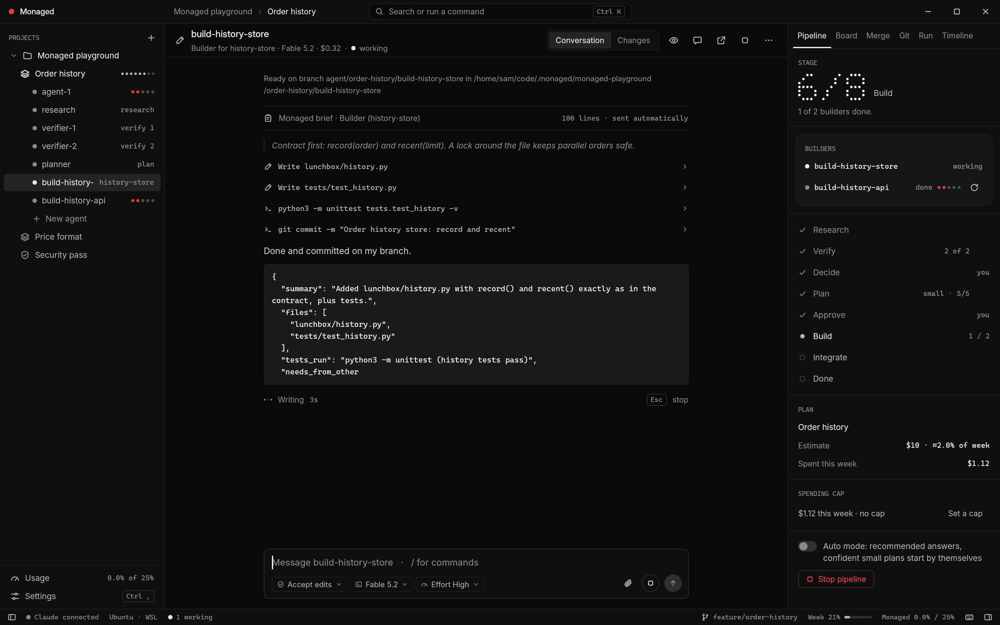
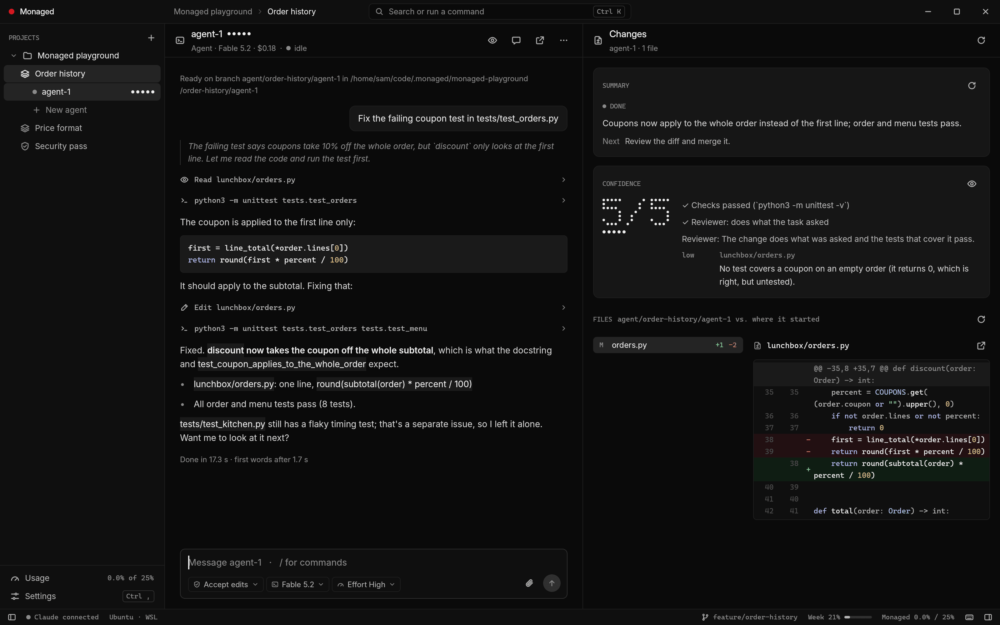
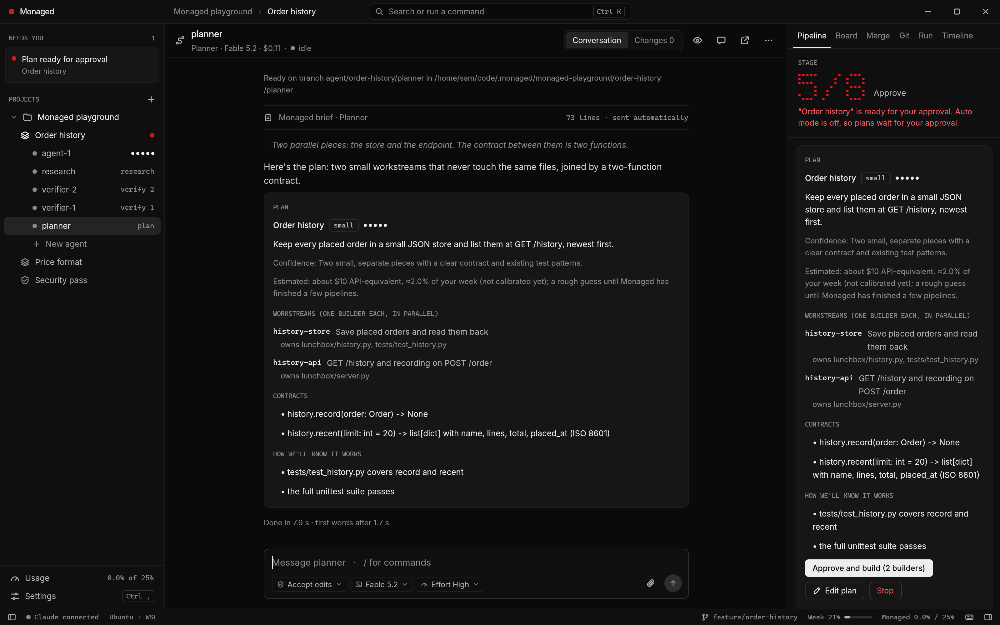
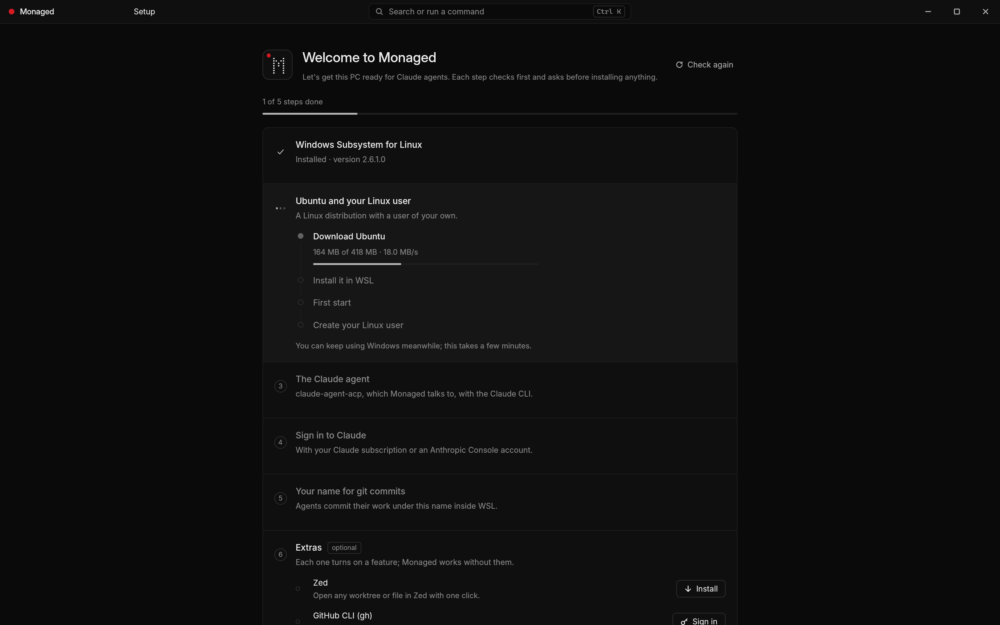
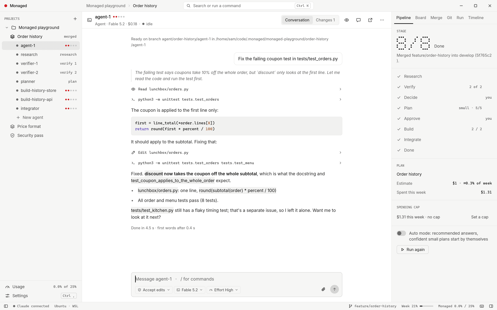

<p align="center">
  <picture>
    <source media="(prefers-color-scheme: dark)" srcset="assets/brand/monaged-logo-dark.svg">
    
  </picture>
</p>

<h3 align="center">One window for every Claude Code agent.</h3>

<p align="center">
  Run Claude Code agents on your projects in parallel, each in its own git worktree inside WSL,<br>
  and see what they did, how sure they are, and what needs you. A native Windows app.
</p>

<p align="center">
  <a href="https://github.com/Marten-Mrfc/monaged/releases/latest"></a>
  <a href="https://github.com/Marten-Mrfc/monaged/actions/workflows/ci.yml"></a>
  
  <a href="LICENSE"></a>
</p>

<p align="center">
  <a href="https://github.com/Marten-Mrfc/monaged/releases/latest"><b>Download for Windows</b></a> ·
  <a href="docs/getting-started.md">Getting started</a> ·
  <a href="docs/user-guide.md">User guide</a> ·
  <a href="docs/troubleshooting.md">Troubleshooting</a>
</p>

<p align="center">
  
</p>

## Why

In a chat app, every conversation for every project lands in one long list. Run two agents on one repo and they edit the same files; ask one to build something big and you're reading a wall of text, hoping it's right.

Monaged gives each **project** its **subprojects**, each subproject its **agents**, and each agent its **own branch and worktree**. They work side by side, they coordinate cheaply, and every change comes with a diff, a summary and a confidence score that shows its reasons.

## Features

- **Projects › subprojects › agents.** A tree for everything, with a "Needs you" inbox on top. Each agent works in its own git worktree, so parallel agents never touch each other's files or your checkout.
- **A pipeline that asks first.** Describe a feature: a researcher reads the code, two verifiers check the research, a planner splits the work into parallel workstreams with contracts, 1–10 builders build it, and an integrator merges it. Large or risky plans (migrations, auth, data, public APIs, security) always wait for your approval; small confident ones can start by themselves.
- **Review with reasons.** Diffs, Haiku summaries and a 1–5 confidence score from your project's tests plus a skeptical review. Failing tests cap the score; every score lists why. Comment on diff lines and send them back.
- **Agents that coordinate.** A shared board for contracts and decisions, file claims that warn about overlaps, and a librarian that answers questions before anyone gets interrupted.
- **Merges on your rules.** A branch chain (develop → acceptance → main) with a rule per target, a merge queue with CI status, and GitHub pull or GitLab merge requests.
- **Git accounts built in.** Sign in to GitHub, GitLab or any host from Settings; tokens stay in Windows Credential Manager and Monaged answers git's credential questions in WSL. No Git Credential Manager, `gh` or `glab` needed. SSH keys, per-project accounts, and a Git tab that commits selected files, amends and undoes.
- **Budget-aware.** Your weekly usage, Monaged's share of it and a cap you choose. Cost estimates on plans; automatic work pauses before your limit.
- **Undo anything.** Every turn is checkpointed: roll back to before any message, undo the rollback, or replay an agent's work turn by turn.
- **Secrets stay secret.** Environment variables encrypted with DPAPI; agents see names, never values; values are masked everywhere and block pushes.
- **Native and keyboard-first.** Built on GPUI (Zed's UI framework). Ctrl K for everything, shortcuts you can change, four themes, and Zed one click away.
- **Set up in minutes.** A setup guide installs WSL, Ubuntu and the Claude agent and signs you in, asking before each step, all inside Monaged with real progress: no console windows, no commands to copy.

<table>
  <tr>
    <td width="50%"></td>
    <td width="50%"></td>
  </tr>
  <tr>
    <td>Every change comes with a summary, a score and its reasons.</td>
    <td>Plans show their size, risks and cost, and wait for you when it matters.</td>
  </tr>
  <tr>
    <td width="50%"></td>
    <td width="50%"></td>
  </tr>
  <tr>
    <td>The setup guide installs what's missing right in the window, with real progress.</td>
    <td>Four themes, one rule: red only means "needs you".</td>
  </tr>
</table>

## Install

1. Download **Monaged-Setup-&lt;version&gt;.exe** from the [latest release](https://github.com/Marten-Mrfc/monaged/releases/latest) and run it. If SmartScreen warns you, click **More info → Run anyway** (the installer isn't code-signed yet; checksums are in `SHA256SUMS.txt`).
2. It installs just for you, without administrator rights.
3. Monaged opens its **setup guide**, which installs WSL and Ubuntu if you need them (you pick your Linux username and password right in the guide), then the Claude agent, and signs you in: Claude's page opens in your browser and you paste the code it shows. It asks before each step.
4. Click **Try the playground** for a hands-on tour, or **Add your first project**.

Already installed? Monaged updates itself (Settings → Updates).

### Requirements

- Windows 10 (version 2004 or later) or Windows 11, x64, with virtualization on.
- WSL 2 with a Linux distribution (the setup guide installs Ubuntu).
- A Claude Pro or Max subscription, or an Anthropic Console account. Agents use your own account.
- Optional: [Zed](https://zed.dev), the [GitHub CLI](https://cli.github.com) (for updates while this repository is private), an Anthropic API key for the Haiku summaries. The setup guide installs them with a click.

## How it works

```
Monaged (Windows, GPUI) ──ACP over wsl.exe──▶ claude-agent-acp (WSL) ──▶ one Claude session per agent
  Project ▸ Subproject ▸ agents                    each session's cwd = its own worktree
        ▲                                                     │ MCP (stdio)
        └──── localhost TCP ◀── monaged.exe --mcp-relay ◀─────┘ (via WSL interop)
```

Monaged runs [claude-agent-acp](https://github.com/agentclientprotocol/claude-agent-acp) inside WSL and talks to it over the [Agent Client Protocol](https://agentclientprotocol.com). Every agent is a session in its own worktree (`~/code/.monaged/<repo>/<subproject>/<agent>`, branch `agent/<subproject>/<agent>`). Agents reach Monaged's coordination tools through a small MCP relay. More in [docs/architecture.md](docs/architecture.md).

## Documentation

- [Getting started](docs/getting-started.md): install, the setup guide, the playground, your first project.
- [User guide](docs/user-guide.md): every feature and the keyboard shortcuts.
- [Troubleshooting](docs/troubleshooting.md): WSL, the agent, signing in, updates.
- [Architecture](docs/architecture.md): how it fits together, and every source file.
- [Roadmap](ROADMAP.md): the decisions behind the design, and what's next.
- [Changelog](CHANGELOG.md), [Privacy](PRIVACY.md), [Security](SECURITY.md).

## Building from source

```powershell
cargo run
```

You need Rust and Visual Studio's C++ build tools (for the Windows SDK). Details, the tests and how releases are made: [CONTRIBUTING.md](CONTRIBUTING.md) and [docs/releasing.md](docs/releasing.md).

## License

Source-available under the [MIT license with the Commons Clause](LICENSE): use Monaged for anything, including at work, change it and contribute. What you can't do is sell Monaged, or a product or service whose value comes mostly from it.

Monaged is an independent project, not affiliated with or endorsed by Anthropic. Claude and Claude Code are trademarks of Anthropic.
