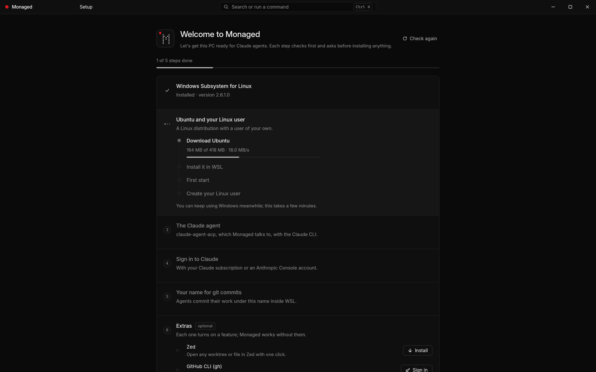

# Getting started

This takes about ten minutes on a PC that has never seen WSL, and two on one that has.

## 1. Install Monaged

1. Download **Monaged-Setup-&lt;version&gt;.exe** from the [latest release](https://github.com/Marten-Mrfc/monaged/releases/latest).
2. Run it. If Windows SmartScreen says it protected your PC, click **More info → Run anyway**. (The installer isn't code-signed yet; the release lists SHA-256 checksums if you want to check the file.)
3. Click **Install**. Monaged goes into `%LOCALAPPDATA%\Programs\Monaged`, just for you, without administrator rights, with Start menu shortcuts and an entry under Settings → Apps.
4. Click **Open Monaged**.

Prefer not to install? The release also has a zip with the same `monaged.exe`; it runs from anywhere, but only an installed copy updates itself.

## 2. Let the setup guide get your PC ready

On first start Monaged opens its setup guide. It checks each thing first and only installs something after you click. Everything happens in the guide itself, with its progress: no console windows and no commands to copy.

| Step | What happens |
|---|---|
| **Windows Subsystem for Linux** | **Install WSL** asks Windows for administrator rights once, then installs WSL in the background while the guide shows what it's doing. Windows usually wants a restart afterwards: **Restart Windows now** does it, and Monaged opens again after you sign in to carry on. |
| **Ubuntu and your Linux user** | Type a Linux username (suggested from your Windows name) and a password, and click **Install Ubuntu**. Monaged downloads Ubuntu from WSL's own catalog (about 420 MB, with megabytes and speed, checked against its checksum), installs it, starts it for the first time and creates your user. That's your account inside WSL, separate from Windows; remember the password, because `sudo` asks for it. Already have a distro? Pick it instead; if it only has root, the same form creates your user. |
| **The Claude agent** | **Install the Claude agent** downloads [claude-agent-acp](https://github.com/agentclientprotocol/claude-agent-acp), which includes the Claude CLI, into `~/.local/share/claude-agent-acp` (about 220 MB). No sudo needed. **Update** fetches the newest one later. If your distro lacks curl, **Install curl and tar** adds them first. |
| **Sign in to Claude** | **Sign in with Claude** (a Pro, Max, Team or Enterprise subscription) or **Use an Anthropic Console account**. Claude's sign-in page opens in your browser; when it shows a code, copy it, paste it into the box in the guide and press Enter. Monaged never sees your password. |
| **Your name for git commits** | Agents commit their work, so git in WSL needs a name and email. The guide fills in the ones git uses on Windows, if any. |
| **Extras** | Optional things that switch features on, each with an **Install** or **Sign in** button: Zed and the GitHub CLI (installed with winget), Git accounts for pushing and pull requests, Claude Code's sandbox tools and pytest (installed in WSL as root, so no password), and an Anthropic API key for cheaper summaries. |

When the required steps have a check mark, the guide says **Monaged is ready**.

You can skip the guide and come back any time: **Ctrl K → Setup guide**, the health check, or the bar Monaged shows when it can't reach Claude.

## 3. Try the playground

**Try the playground** builds Lunchbox in `~/code/monaged-playground`: a tiny lunch-ordering app with a bug, a flaky test and a merge conflict, plus a tour of every feature (also shown inside Monaged).

A good first run:

1. Open **Order history** in the sidebar and press **Ctrl N** to start an agent.
2. Send: *Fix the failing coupon test in tests/test_orders.py*.
3. Watch it work, then look at the **Changes** pane: a summary, a confidence score with its reasons, and the diff.
4. Press **Ctrl K → Run pipeline** and ask for *Add an order history: keep every placed order and list them at GET /history*. Follow it through research, verification, your decision, the plan and the builders.

The playground uses your Claude plan like any other session; each step of the tour says so.

## 4. Add your own project

Click **+** next to Projects (or **Ctrl K → Add a project**):

- **Clone a repo** from GitHub, GitLab or anywhere git can reach. Monaged checks the address and whether WSL can sign in to the host before it starts, and shows git's progress.
- **A folder I have**, inside WSL or on a Windows drive (Monaged offers to clone repos off Windows drives into `~/code`, which is much faster).
- **Start empty**: a new repository.

Then split it into **subprojects**: a *feature* gets its own `feature/<name>` branch, a *standing* concern (like a security pass) gets `standing/<name>`. Every agent in a subproject works in its own worktree on its own branch.

## Next

- [The user guide](user-guide.md): every feature, and the shortcuts.
- [Troubleshooting](troubleshooting.md): when something doesn't work.
