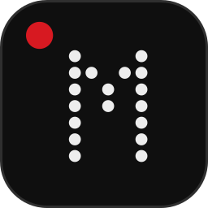

# Monaged brand guide

Monaged looks like the app: monochrome, calm, precise, with one red that means "needs you". This page is for anyone making something about Monaged: the website, a post, a slide.

## The mark

A near-black rounded square with a dot-matrix **M** and a red dot in the top left corner, the same dot as in the app's title bar. The dot-matrix echoes the numerals Monaged uses for the few numbers that matter (usage, scores, stages); the red dot is the accent.

| File | Use |
|---|---|
| `assets/brand/monaged-mark.svg` | The mark alone: app icon, favicon, avatar |
| `assets/brand/monaged-logo-dark.svg` | Mark and name, on dark backgrounds |
| `assets/brand/monaged-logo-light.svg` | Mark and name, on light backgrounds |
| `assets/brand/monaged-wordmark-dark.svg` / `-light.svg` | The red dot and the name, as in the title bar, for tight spaces |
| `assets/brand/monaged-dots-dark.svg` / `-light.svg` | "MONAGED" in the dot-matrix, for big display use only |
| `assets/monaged.ico`, `assets/monaged-256.png` | The Windows icon |
| `assets/brand/social-preview.png` | The card shown when a link to Monaged is shared (1280×640) |

All of them are drawn by `scripts/make_brand.py` and `scripts/make_icon.py`; change those, not the files.

**Do** give the mark room (at least a quarter of its width on every side), keep it square, and use it on near-black or white.
**Don't** recolour the dot, put the mark on busy photos, add effects, or set "Monaged" in another typeface next to it.

## The name

**Monaged**, one word, capital M. Not "MonAged", not "MONAGED" in running text (the dot-matrix wordmark is the only all-caps use). It's an app for running agents, so "agents" is the word for what it runs, and "Claude Code" (two words, both capitalised) is what powers them.

## Colour

Monochrome first. Hierarchy comes from contrast, size and weight, not colour. One accent, red, only ever means "needs you": an approval, a question, a failure. Diff green and red are the only other colours, and only on diffs.

| Role | Dark (Carbon) | Light (Paper) |
|---|---|---|
| Canvas | `#0A0A0A` | `#FFFFFF` |
| Panel | `#0F0F0F` | `#F6F6F5` |
| Raised (cards) | `#161616` | `#FFFFFF` |
| Hairline | `#1E1E1E` | `#E9E9E8` |
| Strong line | `#2F2F2F` | `#D4D4D2` |
| Text | `#EDEDED` | `#111111` |
| Secondary text | `#B4B4B4` | `#4A4A4A` |
| Metadata | `#8A8A8A` | `#6B6B6B` |
| **Red, the accent** | `#D71921` | `#D71921` |
| Red as text | `#FF5A5F` | `#C4141C` |

## Type

- **Inter** (Display for headlines, Text for the rest) on the web and in images; the app uses **Segoe UI Variable** on Windows, which it closely resembles. Two weights: regular and medium (semibold for big headlines).
- **JetBrains Mono** or **Cascadia Mono** for the machine's real data: branches, paths, costs, keys, commands.
- Headlines are short, sentence case, and end with a full stop when they're a sentence: *One window for every Claude Code agent.*

## Screenshots

Real screenshots only, from the app itself (`site/img/`). They're 3200×2000 (2× of a 1600×1000 window) in the Carbon theme, with one in Paper. Show real states: a pipeline at work, a plan waiting for approval, a review with its reasons. Never fake numbers or states the app can't produce.

## Voice

Plain, specific and calm. Say what it does, not how amazing it is.

- **Say** "Each agent works in its own git worktree, so they never edit the same files."
- **Not** "Revolutionary AI-powered multi-agent orchestration platform."
- Short sentences, everyday words, no exclamation marks. Numbers over adjectives ("1–10 builders in parallel", "about five minutes").
- Be honest about limits: Windows only, needs WSL, uses your own Claude account, not signed yet.
- Monaged is independent: never imply Anthropic made or endorses it. When it matters, say "Monaged is an independent project, not affiliated with Anthropic."
